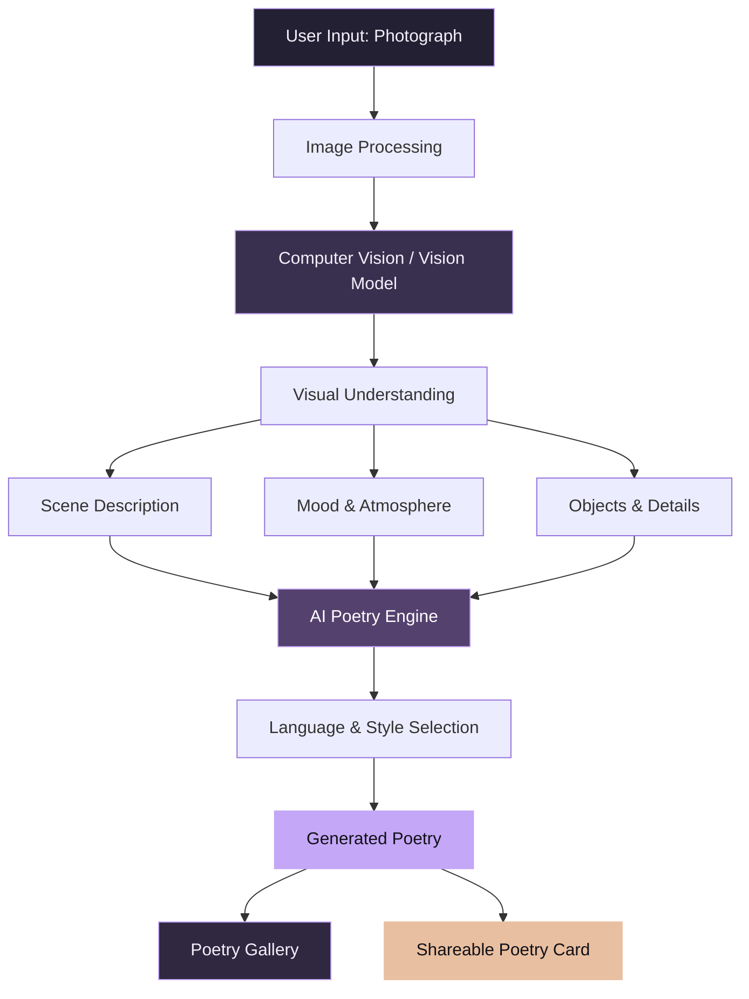

 

 

 

**A photograph captures what you see. Poetry Cam explores what it makes you feel.**

 

## About the Project

**Poetry Cam** is an AI-powered creative camera application that transforms photographs into original, meaningful poetry.

It combines computer vision, image understanding, and generative AI to interpret the visual elements of a photograph — including objects, surroundings, colours, atmosphere, and mood — and turn them into creative expressions.

Capture a photograph or upload an existing image. Let AI explore its visual story and translate that moment into poetry.

The idea is simple: every photograph holds a story, and every story deserves words.

 

## The Concept

 

## Core Features

| Feature                    | Description                                                                     |
| -------------------------- | ------------------------------------------------------------------------------- |
| **AI Image Understanding** | Analyses photographs and identifies visual elements, scenes, and surroundings.  |
| **Instant Poetry**         | Generates original poems inspired by uploaded or captured images.               |
| **Mood Interpretation**    | Uses the atmosphere and visual context to influence poetry generation.          |
| **Poetry Styles**          | Romantic, philosophical, emotional, aesthetic, melancholic, humorous, and more. |
| **Multilingual Poetry**    | Supports creative expression in English, Malayalam, and other languages.        |
| **Custom Generation**      | Adjusts poem length, tone, style, and creative direction.                       |
| **Poetry Gallery**         | Keeps photographs and their generated poems together.                           |
| **Creative Sharing**       | Converts poems into visually appealing shareable cards.                         |
| **Voice Experience**       | Listens to generated poetry through text-to-speech.                             |

 

## How It Works

 

## Poetry Experience

Different photographs deserve different expressions.

| Style         | Experience                                   |
| ------------- | -------------------------------------------- |
| Romantic      | Love, affection, and connection              |
| Melancholic   | Loneliness, memories, and nostalgia          |
| Philosophical | Life, existence, and deeper meanings         |
| Nature        | Beauty, landscapes, and natural surroundings |
| Aesthetic     | Visual beauty and artistic expression        |
| Emotional     | Human feelings and personal experiences      |
| Storytelling  | Turning a photograph into a poetic narrative |
| Minimal       | Short, meaningful poetic expressions         |

 

## Technology

The architecture is designed around modular AI components.

| Layer                   | Technology / Capability                 |
| ----------------------- | --------------------------------------- |
| **Image Intelligence**  | Computer Vision, Vision-Language Models |
| **AI Generation**       | Large Language Models                   |
| **Language Processing** | Natural Language Processing             |
| **Voice**               | Text-to-Speech                          |
| **Image Processing**    | Image Processing Libraries              |
| **Storage**             | Local-First Storage / Database          |
| **Application**         | Cross-Platform Camera Experience        |

*The final technology stack will be documented as development progresses.*

 

## Design Philosophy

Poetry Cam is built around one principle: **the experience should feel as beautiful as the poetry it creates.**

* Minimal and distraction-free interface.
* Photography-first experience.
* Elegant typography and readable poetry layouts.
* Smooth, subtle interactions.
* Dark and light appearance.
* Privacy-conscious image handling.
* Simple capture-to-poetry workflow.

 

## Project Roadmap

* [x] Define product concept and vision.
* [x] Establish core feature direction.
* [ ] Design application UI/UX.
* [ ] Develop camera and image-upload functionality.
* [ ] Integrate AI image understanding.
* [ ] Implement poetry generation.
* [ ] Add poetry styles and customisation.
* [ ] Implement multilingual support.
* [ ] Build poetry gallery.
* [ ] Add poetry card generation.
* [ ] Implement voice narration.
* [ ] Testing and optimisation.
* [ ] Release initial version.

 

## Project Vision

Poetry Cam aims to make creative expression accessible to everyone.

You don't need to be a photographer to capture a beautiful moment. You don't need to be a writer to express it.

Just take a picture. Let the moment speak.

 

### Don't just capture the moment.

### Capture what it feels like.

 

**POETRY CAM** · Photography × AI × Poetry

